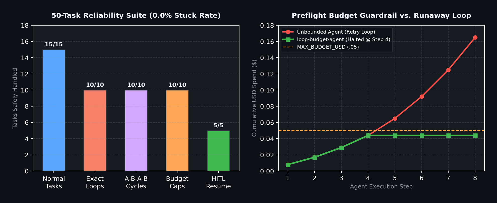

# loop-budget-agent


Runtime guardrails for tool-calling LLM agents built with **LangGraph** and **SQLite**. Prevents infinite tool-call loops, enforces hard token and USD spending limits before every model request, and supports stateful Human-in-the-Loop (HITL) interruption and resumption without duplicating tool side effects.

## Problem

Tool-calling agents often get stuck in retry loops when upstream tools return empty payloads, transient errors, or ambiguous statuses. Without execution-level circuit breakers, an unattended agent burns through token quotas and API credits before timing out.

`loop-budget-agent` wraps a LangGraph `StateGraph` with deterministic runtime checks:
- **Duplicate & Sequence Loop Detection:** Serializes tool arguments (`json.dumps(..., sort_keys=True)`) to catch identical retries (`A -> A`) and alternating tool cycles (`A -> B -> A -> B`) across a configurable history window.
- **Preflight & Post-Call Budget Caps:** Tracks cumulative input/output tokens and estimated USD cost against hard limits (`MAX_TOKEN_BUDGET`, `MAX_BUDGET_USD`). Hard limits cannot be bypassed even after operator approval.
- **Persistent HITL Checkpointing:** Suspends execution via LangGraph `interrupt()` backed by `SqliteSaver`, allowing an operator to inspect the state and resume (`APPROVE` or `STOP`) across process restarts using an execution ledger to prevent duplicate tool execution.

## Architecture

```text
  [Start / Resume Thread]
             |
             v
  +-----------------------------------------+
  | Agent Node                              |
  | (Preflight Token, USD & Step Check)     |
  +-----------------------------------------+
       |               |                |
       | Budget/Steps  | Final Answer   | Tool Calls Requested
       | Exceeded      |                v
       |               |     +-------------------------------------------+
       |               |     | Guardrails & Tool Executor                |
       |               |     | (Signature + A-B-A-B Cycle Detection)     |
       |               |     +-------------------------------------------+
       |               |          |                            |
       |               |          | Loop / Threshold           | Permitted &
       |               |          | Triggered                  | Not in Ledger
       |               |          v                            v
       |               |     +-----------------------+    +----------------------+
       |               |     | HITL Interrupt        |    | Execute Tool &       |
       |               |     | (SqliteSaver Persist) |    | Record Ledger        |
       |               |     +-----------------------+    +----------------------+
       |               |          |            |               |
       |               |          | STOP       | APPROVE       |
       v               v          v            +---------------+
  +-----------------------------------------+                  |
  | Finalize & Persist Terminal State       |                  |
  +-----------------------------------------+                  |
       ^                                                       |
       +-------------------------------------------------------+ (Loop back to Agent)
```

> [!IMPORTANT]
> **Hard Budget Invariant:** Even when a human operator issues an `APPROVE` command to override a loop warning, `loop-budget-agent` still enforces `MAX_TOKEN_BUDGET` and `MAX_BUDGET_USD` preflight checks before every LLM call so approved threads cannot overrun spending caps.

## Interactive Execution Traces

Click any scenario below to inspect the runtime guardrail logs:

<details>
<summary><b>1. Exact-Duplicate Tool Loop Caught & Escalated to HITL</b></summary>

```text
$ uv run loop-agent --mock run "Retry status check for order 999"
[step 1] tool_call: check_order_status({"order_id": 999}) -> {"status": "PENDING"}
[step 2] tool_call: check_order_status({"order_id": 999}) -> {"status": "PENDING"}
[guardrail] LOOP_DETECTED: Duplicate signature check_order_status({"order_id": 999}) (count=2)
[hitl] Thread suspended via SqliteSaver checkpoint (thread_id=thr_84a1)
[hitl] Awaiting operator command: APPROVE | STOP
```
</details>

<details>
<summary><b>2. Hard USD / Token Budget Preflight Cutoff</b></summary>

```text
$ uv run loop-agent run "Deep audit across all warehouse manifests"
[step 1] tokens: 2,410 | est_cost: $0.0121 / $0.0500
[step 2] tokens: 6,890 | est_cost: $0.0345 / $0.0500
[preflight] BUDGET_EXCEEDED: Projected call exceeds MAX_BUDGET_USD ($0.0500)
[finalize] State persisted cleanly. Zero runaway API calls.
```
</details>

<details>
<summary><b>3. 50-Task Deterministic Reliability Benchmark Output</b></summary>

```text
$ uv run loop-agent --mock eval
Scenario Breakdown:
  - Normal Multi-Step Tasks:        15/15 passed
  - Exact Duplicate Retries (A->A): 10/10 intercepted
  - Alternating Cycles (A->B->A->B): 10/10 intercepted
  - Hard Token / USD Budget Caps:   10/10 halted preflight
  - HITL Interrupt & Resume:         5/5 verified (0 duplicate side effects)
------------------------------------------------------------------
Passed 50/50 (100.0%) | Stuck Rate: 0.0% -> results/benchmark.json
```
</details>

## Project Structure

```text
loop-budget-agent/
├── src/loop_budget_agent/
│   ├── state.py          # AgentState TypedDict and Pydantic v2 runtime settings
│   ├── tools.py          # Deterministic order/warehouse tools with simulated failure modes
│   ├── guardrails.py    # Exact-duplicate and alternating-sequence loop detection engine
│   ├── budget.py         # Token accounting, USD cost estimation, and hard budget enforcement
│   ├── persistence.py    # SQLite checkpointer lifecycle and thread recovery helpers
│   ├── agent.py          # LangGraph StateGraph wiring, execution ledger, and HITL routing
│   ├── cli.py            # Rich CLI interface for live, mock, resume, and benchmark modes
│   └── evaluate.py       # 50-task deterministic reliability and Stuck Rate benchmark
├── tests/                # Offline pytest suite (34 unit & integration tests)
├── results/              # Generated benchmark JSON/Markdown reports and charts
├── .env.example
└── pyproject.toml
```

## Setup & Usage

Requires Python 3.11+ and [`uv`](https://docs.astral.sh/uv/).

```bash
git clone [https://github.com/Sujalgarg84/loop-budget-agent.git](https://github.com/Sujalgarg84/loop-budget-agent.git)
cd loop-budget-agent
uv sync --extra dev
```

### Offline Mode (No API Key Required)

Runs with a deterministic mock model to exercise tool calls, loop detection, and budget cutoffs:

```bash
uv run loop-agent --mock run "What is 17 * 24?"
```

### Live Gemini Mode

Copy `.env.example` to `.env` and set your Google AI Studio key:

```bash
cp .env.example .env
```

```env
GOOGLE_API_KEY=your_api_key_here
GEMINI_MODEL=gemini-3.5-flash-lite
MAX_ITERATIONS=10
MAX_TOKEN_BUDGET=10000
MAX_BUDGET_USD=0.05
```

Run a task against the live model:

```bash
uv run loop-agent run "Check whether order 1024 has been shipped"
```

## Evaluation Benchmark

`evaluate.py` runs 50 deterministic tasks covering normal execution, exact duplicate retries, alternating `A-B-A-B` cycles, flaky tool responses, budget exhaustion, and HITL escalations:

```bash
uv run loop-agent --mock eval
```

```text
Passed 50/50 (100.0%) -> results/benchmark.json
```



- **Stuck Rate:** `(unhandled_or_unbounded_tasks / total_tasks) * 100`. Tasks terminated cleanly by budget caps, loop circuit breakers, or operator `STOP` decisions are counted as safely handled (`0.0%` stuck rate).

## Running Tests

All 34 unit and integration tests run offline without network access or API credentials:

```bash
uv run pytest -v
```

## Limitations & Trade-offs

- **Exact vs. Semantic Loop Detection:** Tool signatures match normalized JSON arguments; semantically equivalent calls with varied phrasing or dynamic timestamps require embedding-based similarity checks.
- **Simulated Business Tools:** Included order and warehouse tools are deterministic local functions designed to reproduce flaky API edge cases safely.
- **Single-Node SQLite Checkpointer:** `SqliteSaver` fits local CLI usage and single-process recovery; multi-worker deployments should use `PostgresSaver`